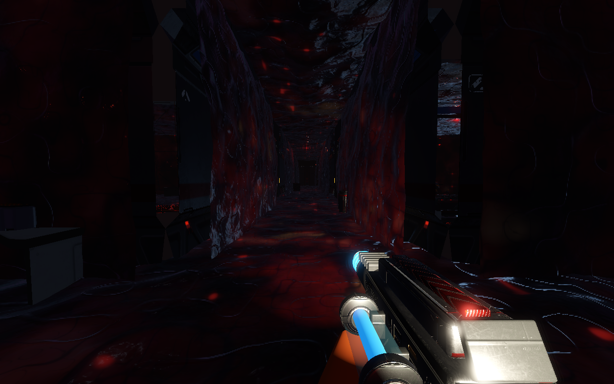

# Verdigris Protocol

> *The alien isn't aboard the station. It's growing through it.*

A first person horror shooter against a spreading alien growth, built with
Godot 4 and [COGITO](https://codeberg.org/Phazorknight/Cogito) from
Quaternius' sci-fi kits. Design:
[idea 21](https://github.com/LinuxGroove/game-ideas/blob/main/ideas/21-verdigris-protocol.md)
in game-ideas.



You're the night shift engineer on Marigold, a farming station where
something came up through the soil in Hydroponics. Now a red, wet growth
called the Bloom spreads through the decks room by room, taking the crew as
it goes. Burn it back with a plasma cutter, cut the power it feeds on, seal
doors, light flares, and dig out the Heart that roots each deck.

- **Eight decks round a ring.** Hydroponics first, then Crew, Medical, Labs,
  Security, Engineering and Cargo in any order, then the Core. Every hour
  you spend on one, the others lose ground; a deck you leave too long is
  lost to the Bloom, though you can take it back.
- **Saving a deck helps.** Survivors, stims, the rail rifle, turrets, spare
  power cells and, at Cargo, a shuttle home. What you saved decides how the
  night shift ends.
- **The growth spreads in real time,** through open doors, along power
  lines and into the dark. Light slows it; sealed doors hold it; a dead
  Heart starves it.
- **Gore** you can turn down: Full, Less or Off, with a code to lock it.
- **Comfort settings:** no head bob or view roll unless you want them, calm
  walls and no spore blur.
- **Shift mode,** once you've seen an ending: a new station every night,
  three decks to hold, with online boards for tonight's station.
- Plays fully offline, with a keyboard and mouse or a controller.

## Playing

Get it from the Snap Store once it's published (`snap install verdigris-protocol`),
or run it from source with Godot 4.7:

```sh
godot --headless --path . --import && godot --headless --path . --import
godot --path .
```

Screenshots of every deck and menu are in [docs/screenshots](docs/screenshots/README.md).
[CLAUDE.md](CLAUDE.md) covers how the game is built, and
[CREDITS.md](CREDITS.md) who made what.

## License

The code is MIT (see [LICENSE](LICENSE)). The art and sounds are CC0, apart
from COGITO's and the fonts; see [CREDITS.md](CREDITS.md).
